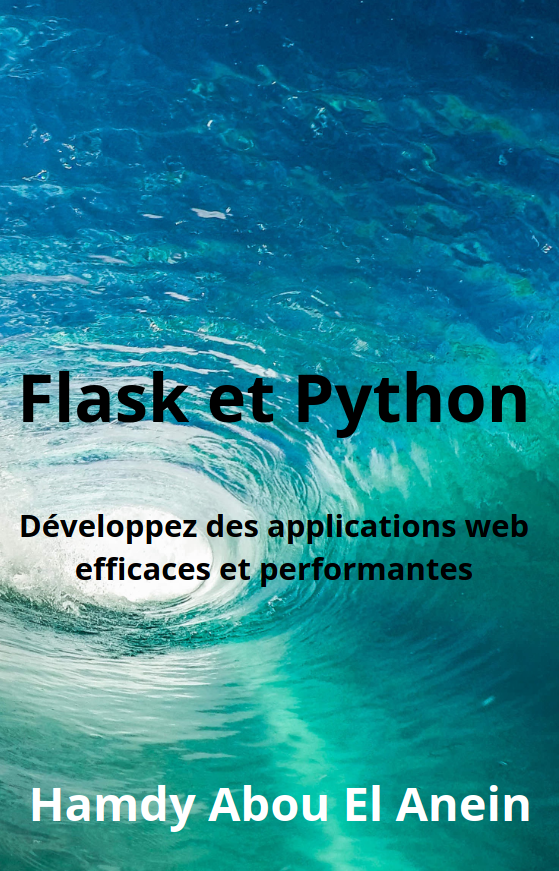

# Programmes du livre : [Flask et Python : Développez des applications web efficaces et performantes](https://www.amazon.fr/dp/B0C2SQ8NW2/ref=tmm_pap_swatch_0?_encoding=UTF8&qid=&sr=)      
       

Auteur : [Hamdy Abou El Anein](https://www.amazon.fr/Hamdy-Abou-El-Anein/e/B0BM89T88X/ref=aufs_dp_fta_dsk)    

## Maintenance and regression tests

Maintainer: Hamdy Abou El Anein — hamdy.aea@protonmail.com

Install `requirements.txt` in a virtual environment. Run `python3 -m unittest -v` from the repository root. The runnable chapter servers no longer enable the debugger by default. Three tests cover basic routes, HTML escaping and random-number boundary rendering for all four chapters. These are local learning examples, not production deployments. Original chapter organization is retained.
